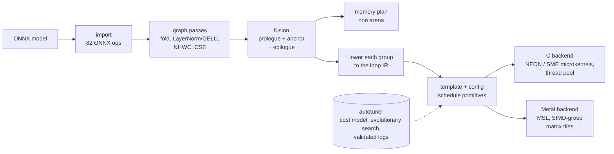

# Tessera

[](https://github.com/MatiiiBL/tessera/actions/workflows/ci.yml)


Tessera is a tensor compiler for Apple silicon. It takes an ONNX model and
compiles it into native code for the CPU (C with NEON and SME
microkernels) or the GPU (Metal).

The design follows TVM's TensorIR:
1. The graph is optimized and fused into groups.
2. Each group is lowered to a loop IR of blocks.
3. A template schedules the loops with semantics-preserving primitives
   (split, reorder, `compute_at`, `cache_read`, `tensorize`, ...).
4. An autotuner picks each template's parameters with a learned cost model.

Everything from the ONNX importer to the code generators is written from
scratch in Python, plus about 1,600 lines of C and Objective-C. It runs on
a stock Mac: clang from the Command Line Tools, and Metal shaders compiled
at run time, so Xcode is not needed.



## Results

Batch-1 float32 latency on an Apple M4 (4 performance cores, 10-core GPU,
16 GB), median of at least 50 runs with nothing else running. Times are in
milliseconds; lower is better.

| model | ONNX Runtime CPU | PyTorch CPU | PyTorch MPS | Tessera CPU (`c:sme`) | Tessera GPU (`metal`) |
|---|---|---|---|---|---|
| ResNet-50 | 12.14 | 13.18 | 12.28 | 11.52 | **10.71** |
| MobileNetV2 | 2.43 | 15.25 | 6.62 | 2.15 | **1.74** |
| BERT-base (128 tokens) | 21.97 | 26.46 | 14.85 | 18.06 | **10.31** |
| GPT-2 (128-token prefill) | 30.54 | 39.10 | 22.13 | 32.68 | **14.18** |

| What | Result |
|---|---|
| GPU | Fastest system on all four models: 1.13x the best baseline on ResNet-50, 1.40x on MobileNetV2, 1.44x on BERT, 1.56x on GPT-2 |
| CPU | Faster than ONNX Runtime on ResNet-50 (1.05x), MobileNetV2 (1.13x) and BERT (1.22x); slower on GPT-2 (0.93x) |
| Accuracy | Every output within 3e-6 of ONNX Runtime, relative to the output's largest magnitude; the image models pick the same top-1 class on all 16 test images |
| Autotuning | Up to 1.58x per model over the templates' defaults (ResNet-50 on Metal). 25,651 measurements are committed as logs |
| Fusion | 37 to 53% as many kernels and 23 to 43% fewer bytes moved; faster on every model on Metal |
| Memory planning | One arena 3.9 to 31x smaller than the intermediate tensors it holds (BERT: 2.3 MiB for 72.1 MiB) |
| Kernels | SME GEMM 1.16 to 1.47x Accelerate on the transformer layers' shapes; Metal GEMM within 3% of MPS at 2048³ |
| Code | 28k lines of Python, 1.6k of C/Objective-C, 14k of tests (1,374 tests); `mypy --strict`; CI on Linux and macOS |

The full tables have percentiles, untuned rows, a NEON-only CPU target and
every ablation: [results/models.md](results/models.md), kernel throughput
in [results/ops.md](results/ops.md), and [docs/evaluation.md](docs/evaluation.md)
for the method.

## Quick start

Requires an Apple-silicon Mac with Python 3.12+ and
[uv](https://docs.astral.sh/uv/). On Linux, the portable C target
(`c:generic`) and the tests run, but SME and Metal do not.

```sh
git clone https://github.com/MatiiiBL/tessera && cd tessera
uv sync
make models    # export ResNet-50, MobileNetV2, BERT and GPT-2 to ONNX (downloads the weights once)

# Compile and run a model, checking the result against the reference interpreter.
uv run tessera run data/models/resnet50.onnx --target metal --check
uv run tessera run data/models/bert.onnx --target c:sme --check

# Look inside: the fused groups, one group's scheduled loop IR, the generated code.
uv run tessera inspect data/models/gpt2.onnx --stage fused --target c:sme
uv run tessera inspect data/models/resnet50.onnx --stage tir --target metal --group layer1_layer1_0_conv2_Conv
uv run tessera inspect data/models/resnet50.onnx --stage code --target metal

# Per-kernel times, a short tuning run of your own, and the benchmark pages.
uv run tessera profile data/models/mobilenet_v2.onnx --target c:sme
uv run tessera tune data/models/mobilenet_v2.onnx --target c:sme --trials 300 --log my-tuning.jsonl
uv run tessera run data/models/mobilenet_v2.onnx --target c:sme --log my-tuning.jsonl
uv run --group bench tessera bench models
```

From Python:

```python
import numpy as np
import tessera

model = tessera.compile("data/models/resnet50.onnx", target="metal")
image = np.random.rand(1, 3, 224, 224).astype(np.float32)
outputs = model.run({"input": image})                  # dict of NumPy arrays
seconds = model.benchmark({"input": image}, repeat=50)  # one entry per run
```

The committed tuning logs in `results/tuning/` are used by default. On a
machine other than an M4 with 4 performance cores, every kernel falls back
to its template's default configuration.

## How it works

**Graph.** The ONNX importer maps 82 ONNX operators onto 50 internal ones.
Each internal operator has shape inference, a NumPy reference and a fusion
kind (elementwise, broadcast, injective, reduction, anchor).
- Optimization passes fold BatchNorm into convolutions, recognize LayerNorm
  and GELU patterns, move images to NHWC with HWIO weights, and remove
  common subexpressions and dead code.
- Fusion builds groups around one anchor (a convolution or matmul) or
  reduction: injective ops in front of it (prologue) and elementwise ops
  behind it (epilogue). Cheap producers are duplicated into each consumer
  rather than written to memory.
- A best-fit planner places every intermediate in one arena by liveness.

See [docs/graph.md](docs/graph.md).

**Loop IR.** Each group becomes a `PrimFunc`: loops around blocks with
explicit iteration domains, read and write regions, and reduction inits,
as in TensorIR. Schedule primitives rewrite the loops around blocks and
never what a block computes. Each primitive checks its own legality and
refuses with an error rather than miscompiling. `tensorize` matches a loop
nest against a microkernel's description, including predicated edge tiles,
and replaces it with a call. A Python interpreter runs any scheduled
function, which is how every schedule is tested against its unscheduled
original. See [docs/tir.md](docs/tir.md).

`tessera inspect --stage tir` prints the schedule each kernel got. Here is
an excerpt for a tuned ResNet-50 convolution on Metal (the ReLU epilogue is
inlined into the tile's write-back):

```
# layer1_layer1_0_conv2_Conv: conv2d:2dbf9e66c8b71376, tuned config {'strategy': 'simdgroup', 'simd_k': 32, ...}
#   split(ow, [None, 1, 8]) -> [ow_0, ow_1, ow_2]
#   split(o, [None, 1, 64]) -> [o_0, o_1, o_2]
#   reorder([n, oh, ow_0, o_0, ow_1, o_1, kh, kw, ic_0, ow_2, o_2, ic_1])
#   bind(o_0, 'threadgroup.x')
#   cache_write('layer1_layer1_0_conv2_Conv', 0, 'shared') -> 'layer1_layer1_0_conv2_Conv_shared'
#   reverse_compute_at('layer1_layer1_0_conv2_Conv_shared', o_1)
#   reverse_compute_inline('layer1_layer1_0_relu_1_Relu')
```

**C backend.** Generates C11 that clang compiles into one library per
model, loaded with ctypes. GEMMs and convolutions (as implicit GEMMs, with
no im2col buffer) run on hand-written microkernels:
- NEON: an 8×12 register tile.
- SME: a 32×32 block of C held in the ZA array, four `fmopa` outer products
  per step, entering streaming mode once per macro block.

Weights are packed into panels once, on first use, and kept. Parallel
loops run on a persistent thread pool on the performance cores. See
[docs/cpu.md](docs/cpu.md).

**Metal backend.** Generates Metal Shading Language from the same loop IR
and compiles it at run time through a small Objective-C shim. Thread-bound
loops become the grid, shared buffers become threadgroup memory, and matmul
tiles use `simdgroup_float8x8` matrix operations. One inference is a single
command buffer. See [docs/metal.md](docs/metal.md).

**Autotuner.**
- **Tasks.** Every distinct group is a task (its structure and constant
  inputs, hashed). The four models have 78 tasks per target, with 3.1
  million configurations in all on `c:sme` and 420 million on Metal.
- **Search.** An evolutionary search proposes candidates. A gradient-boosted
  cost model (written in NumPy, trained on loop-nest features) ranks them.
- **Measurement.** Candidates compile in parallel processes and are
  measured one at a time in separate processes with timeouts, so a crash or
  hang costs one candidate.
- **Validation.** After the search, the best configurations are re-measured
  against the default in alternation, then once more inside the compiled
  models. A configuration that is not faster in the model is not used.

See [docs/tuning.md](docs/tuning.md).

## Design decisions

- **Schedules that can be checked.** Separating what a block computes from
  the loops around it keeps every primitive's legality check local, and
  means any schedule can be compared with the unscheduled function. A
  randomized test applies up to ten random primitives to random
  computations and checks the result every time.
- **Microkernels by tensorization, not by code generation alone.** The
  inner loops that matter are written by hand once per ISA and matched
  structurally, so templates only have to decide tiling, ordering and
  parallelism. Without schedules, the C code is 28 to 417x slower;
  without SME, 2.2 to 2.9x slower on three of the four models.
- **Time what the model runs.** The first tuning run made GPT-2 on the CPU
  slower, because timings taken alone disagreed with times inside the
  model. The main cause was thread placement: macOS moved busy SME worker
  threads to the efficiency cores, and a spinning worker stayed there.
  - Idle workers now sleep, iterations are claimed dynamically, and a
    worker woken on an efficiency core leaves the loop to the others.
  - Kernels are timed with cold, pre-packed weights, as a model run reads
    them.
  - Tuned configurations are validated inside the models before they are
    used.
- **Fusion has to earn its place.** Fusing the attention heads' transpose
  into the output projection made that kernel 3x slower than its unfused
  parts: its operand was no longer a plain matrix, so the microkernel
  could not apply. A lowering option now gives such an operand its own
  block, which the backends compute once per element into fast memory.
  Fused is now faster than unfused on every model on Metal, and level
  with it on the CPU.
- **Measure like a skeptic.**
  - Each result file records the commit, the machine and the load average.
    A run on a busy machine is marked provisional.
  - CPU numbers pool five fresh processes so that one unlucky thread
    placement can't decide a median.
  - Baselines get their fastest configuration, for example PyTorch's fused
    attention.

## Testing

`make check` runs ruff, `mypy --strict` and pytest (1,374 tests, about a
minute and a half).
- Operators and their loop-IR definitions are tested against their NumPy
  references. Generated C and Metal kernels are tested against the
  interpreter or NumPy, including edge tiles and odd shapes.
- Hypothesis property tests cover the simplifier, bounds analysis,
  convolution definitions and imperfect splits.
- End-to-end tests compile small ONNX models built like the real ones (a
  CNN, an MLP, a transformer block) for every target and compare them with
  the interpreter and ONNX Runtime.
- `pytest -m models` (28 more tests) runs the four real models through the
  graph pipeline against ONNX Runtime, lowers and schedules every group,
  and lowers every ablation. The benchmarks check every compiled model's
  outputs against ONNX Runtime.
- CI runs the suite on Ubuntu (the portable C target) and macOS.

## Repository layout

```
src/tessera/
  frontend/        ONNX import
  ir/              graph IR, operator registry, NumPy references, interpreter
  passes/          optimization, fusion, layout, memory planning
  te/, compute/    tensor expressions; lowering fused groups to the loop IR
  tir/             loop IR, schedule primitives, tensorize, interpreter, verifier
  backend/c/       C code generation, templates, NEON/SME microkernels, runtime
  backend/metal/   MSL generation, templates, Objective-C runtime shim
  tune/            tasks, features, cost model, search, measurement, logs
  bench/           model, kernel and tuning benchmarks
  driver.py        tessera.compile
  cli/             the tessera command
docs/              design, one document per package, evaluation
results/           benchmark tables (Markdown and JSON) and the tuning logs
scripts/           model export, graph statistics
```

Start with [docs/design.md](docs/design.md), which defines the contracts
between packages. Each package has its own document with measurements.

## Limitations

- **Batch 1, float32, static shapes.** There are no int8 or float16
  kernels, and dynamic dimensions must be fixed at compile time.
- **CPU convolutions trail PyTorch's.** Measured kernel by kernel, the
  `c:sme` code is faster than PyTorch on the CPU on 4 of ResNet-50's 23
  convolution shapes. The whole model is still faster than PyTorch's
  (11.52 against 13.18 ms), but the convolution kernels have room to
  improve. Large square GEMMs and GPT-2's vocabulary projection are slower
  than Accelerate (0.71x and 0.66x).
- **Thread placement on the CPU.** macOS sometimes keeps one SME worker on
  an efficiency core for a whole process, which then runs on three
  threads: ResNet-50 takes about 15.5 ms instead of 12. This is pooled out
  of the medians but visible in the percentiles; no user-space fix is
  known.
- **Strided convolutions on Metal.** Six of ResNet-50's seven strided
  convolutions are slow on Metal: 212 to 322 GFLOP/s, against a median of
  1,374 over all its convolution shapes.
- **Tuning covers a small part of each search space,** and the logs are
  specific to the M4 they were made on.

## License

MIT
