# Graph

The graph package takes a model from an ONNX file to the two things the rest
of the compiler needs: a list of fused groups, one per kernel, and a memory
plan that says where every tensor lives at run time. It has three parts:

- `tessera.ir`: the graph IR, the operator registry (shape inference and a
  NumPy reference for every operator) and the interpreter.
- `tessera.frontend.onnx`: the ONNX importer.
- `tessera.passes`: `optimize`, `fuse`, `verify_groups` and `plan_memory`.

```python
from tessera.frontend import onnx
from tessera.ir import interpret
from tessera.passes import fuse, optimize, plan_memory

graph = optimize(onnx.load("data/models/resnet50.onnx"))
groups = fuse(graph)               # 56 kernels
plan = plan_memory(graph, groups)  # 10.0 MiB arena
interpret(graph, {"input": image}) # the reference result
```

The measurements in this document come from `results/graph/models.md`, which
`uv run python scripts/graph_stats.py` regenerates from the exported models.

## The IR

A `Graph` is a list of `Node`s in topological order over `Value`s. Every
value has one definition: a graph input, a constant (it carries a NumPy
array) or a node output. Shapes are static, since a model is compiled for
one input shape. Names are unique identifiers (`[A-Za-z0-9_]`), because they
become kernel names in generated C and Metal. `Graph.io_names` keeps the
model's own name for each input and output: an ONNX input called `input.1` is
`input_1` in the graph, and `io_names["input_1"] == "input.1"`.

### Operators and attributes

Every operator is registered once (`tessera/ir/opdefs/`) with its fusion
kind, shape inference, a NumPy reference and a normalizer. Attributes have
two spellings:

- **Lenient**, as a builder or importer writes them: defaults omitted,
  negative axes, ONNX conventions (`Reshape(shape=(0, -1))`, Slice with an
  `axes` subset and out-of-range ends, Expand's two-way broadcasting, pads
  given as `(pad_h, pad_w)`).
- **Normalized**, as the graph stores them: every attribute present, axes
  non-negative and sorted, one entry per dimension, Reshape and Expand
  shapes fully explicit, Slice starts and ends clamped into the dimension.

`Graph.add_node` (and the shorthand `g.op("Softmax", x)`) normalizes, then
infers the output types. Shape inference accepts only normalized attributes,
so a node built some other way with `axis=-1` fails `Graph.verify` with a
message naming the node. Bad inputs fail with a `ShapeError` that names the
node and says what is wrong ("MatMul node 'proj': inner dimensions differ:
float32[2,3] @ float32[4,5] (3 != 4)"). Code after `optimize` can therefore
read any attribute without knowing its default.

The 44 canonical operators are those of design Section 3. Six more ONNX
operators (Gemm, Flatten, Squeeze, Unsqueeze, Identity, Dropout) exist so
that an imported graph can be verified and interpreted before optimization;
their kind is OPAQUE, `optimize` always removes them, and `fuse` rejects
them.

The references compute in the input's element type and keep it, so the same
function runs a float32 graph or a float64 one. `Erf` (and exact GELU) goes
through `math.erf` in float64, because NumPy has no vectorized erf.
`Conv2d` runs one batched matrix product per kernel offset, which handles
groups, strides, dilation and padding in one path and is fast enough to
interpret ResNet-50 in under 0.1 s.

### The interpreter

`interpret(graph, inputs)` runs the nodes in order with their references,
checks every result against the node's output type, frees each value after
its last reader and returns the outputs by name. `float64=True` converts float
inputs and constants to float64 and keeps every float value in float64 (an
explicit `Cast` still rounds). That is the reference compiled kernels are
compared against, with a tolerance relative to it. `intermediates=True`
returns every value, for debugging one kernel at a time. `random_inputs(graph)`
makes inputs for tests.

## ONNX import

`onnx.load(model, input_shapes)` converts each ONNX node with a converter
(82 ONNX operators are supported; `tessera.frontend.onnx.SUPPORTED_OPS`).
Converters build Tessera nodes through one function that **evaluates a node at
once when all its inputs are constants**, with the operator's reference. That
is how shape subgraphs disappear: `Shape` becomes a constant from the static
type, the `Gather`/`Unsqueeze`/`Concat` that assemble a target shape are
evaluated as they are built, and by the time `Reshape` asks for its shape
input, it is a constant. ResNet-50 has no such nodes, so its 122 ONNX nodes
stay 122 after import. BERT drops from 547 to 420 and GPT-2 from 735 to 486:
almost all of the removed nodes are `Constant` nodes (110 and 243), and the
rest is shape and mask arithmetic on constants.

Some ONNX operators only make sense on constants (`Range`,
`ConstantOfShape`, `Trilu`, `GatherElements`, `CumSum`, `NonZero`, rounding
functions). They are evaluated directly and are an error on a computed input,
because the output shape would depend on data. Other conversions:

- Variadic `Max`/`Min`/`Sum`/`Mean` become chains; `Not`, `And`, `Or`,
  `Xor`, `LessOrEqual` and `GreaterOrEqual` become `Equal` and `Where` on
  bools; `Reciprocal`, `Softplus`, `LeakyRelu` and `ReduceMin` are spelled
  with canonical operators.
- `Split` becomes one `Slice` per output; a negative-step `Slice` becomes a
  `Gather` of the selected indices; negative `Pad` crops with a `Slice`.
- 1-D convolutions become 2-D ones over a height of 1. `auto_pad` and
  `ceil_mode` become explicit pads (a max pool's extra padding never wins;
  an average pool with a partial last window is rejected).
- `Softmax` before opset 13 normalizes a flattened 2-D view, so it becomes
  Reshape, Softmax, Reshape when the axis is not the last.
- `LayerNormalization` gets its scale and bias broadcast to the normalized
  shape, and a zero bias when it has none.

Each node takes its ONNX node's name, or its first output's name when it
has none, so kernels are named after the model's layers. Input and output
names are the ONNX names (made identifiers). An output
whose value cannot take its name, because it is a constant, a graph input
or the same value as another output, is returned through a same-shape
Reshape view that carries the name. The memory plan turns that view into a
copy. Dynamic dimensions must be given in `input_shapes`. Anything
unsupported is an error that names the ONNX node.

## Optimization

`optimize(graph, *, layout="NHWC", fold=True)` returns a new graph. It is
built from local rewrite rules (`passes/rewrite.py`): a rule looks at one
node and returns an equivalent value or nothing. The rewriter applies a list
of rules to every node in topological order, records each replacement and
resolves it when the readers are visited, so a sweep is linear. It sweeps
until no rule fires. New nodes are appended and sorted into place at the end
of a sweep; dead nodes are removed. A replacement takes the exact name of the
node it replaces, so kernel names after optimization are the ONNX node names
(`layer1_layer1_0_conv1_Conv`).

The pipeline, in order:

1. **Canonical operators.** Gemm becomes MatMul and Add, with `transB`
   applied to the constant weight at compile time and `alpha`/`beta` folded
   into constant operands. Flatten, Squeeze and Unsqueeze become Reshape;
   Identity and Dropout disappear. A BatchNorm whose input is a Conv2d read
   only by it is **folded** into the convolution: `w * k` and
   `(b - mean) * k + beta` with `k = gamma / sqrt(var + eps)`. Any other
   BatchNorm becomes a per-channel Mul and Add. Grouped convolutions that are
   not depthwise are split into one convolution per group and a Concat,
   because no template implements them.
2. **Patterns** (`passes/patterns.py`). Exporters spell some operators out;
   the matchers recognize:
   - LayerNorm as `(x - mean(x)) / sqrt(mean((x - mean)^2) + eps)` over
     trailing axes, with division or multiplication by `Rsqrt`. A following
     per-element Mul and Add are absorbed into its scale and bias.
   - GELU as `x * 0.5 * (1 + erf(x / sqrt(2)))` in any association of the
     product, and the tanh form `0.5 x (1 + tanh(sqrt(2/pi) (x + 0.044715 x^3)))`
     with the cube as `Pow` or as products.
   - SiLU `x * sigmoid(x)`, HardSwish `x * HardSigmoid(x)` and Rsqrt `1 / sqrt(x)`.

   Constants match within a relative 1e-4, since exporters round them.
3. **Simplification, folding, CSE and DCE**, repeated until nothing changes.
   - No-op nodes are removed: an identity Reshape, Transpose, Cast, Slice or
     Pad, and `x + 0` or `x * 1` when the constant does not broadcast `x`.
   - Chains of Reshapes and of Transposes merge, and a Transpose that only
     moves size-1 axes becomes a Reshape.
   - Two rules keep matrix products batched. `MatMul(Reshape(x), W)`, where
     the Reshape only merges leading axes into rows, becomes
     `Reshape(MatMul(x, W))`. A Reshape that keeps the last axis moves below
     elementwise operators and below broadcasts of a last-axis vector. An
     exported `Linear` (Reshape to rows, Gemm, Reshape back) thus becomes one
     3-D MatMul with its bias, activation and residual add next to it, which
     fusion turns into one kernel.
   - Constant folding evaluates any node whose inputs are all constants,
     unless that would turn small constants into a much larger one: an output
     over 1 MiB and over 4 times its inputs, such as an Expand of a scalar.
   - CSE merges equal constants (by type and bytes) and nodes with the same
     operator, inputs and attributes. DCE removes everything no output
     depends on.
4. **Layout** (`passes/layout.py`), for `layout="NHWC"`. Each NCHW
   convolution or pooling node becomes `Transpose(NHWC->NCHW)` of the NHWC
   operator on `Transpose(NCHW->NHWC)` of its input. The weight is relaid
   out from OIHW to HWIO at compile time. Transposes then move toward the
   outputs:
   - through elementwise operators;
   - through broadcasts, with constant operands relaid out;
   - through reductions, Softmax, Concat, Pad and Slice, with their axes
     renumbered;
   - through LayerNorm when its normalized axes stay in place.

   Two transposes in a row compose, so one convolution's output transpose
   meets the next one's input transpose and both vanish. After global average
   pooling, the remaining transpose only moves size-1 axes and becomes a
   Reshape. ResNet-50 and MobileNetV2 end with exactly one Transpose, at the
   input, which fuses into the first convolution as a prologue.

`fold=False` is the minimal legal pipeline, used for ablations. It does only
what canonical form requires: ONNX-only operators rewritten (constant weights
still relaid out, scale factors left as Mul nodes), BatchNorm decomposed
(never folded into the convolution), grouped convolutions split, the NHWC
layout pass, and dead-code elimination. It runs no pattern rewrites, no
simplification, no constant folding and no CSE. Both pipelines keep input and
output names (`Graph.name_outputs`).

| Model | ONNX nodes | Imported | Optimized | Optimized, `fold=False` |
|---|---:|---:|---:|---:|
| resnet50 | 122 | 122 | 124 | 125 |
| mobilenet_v2 | 170 | 100 | 102 | 103 |
| bert | 547 | 420 | 370 | 420 |
| gpt2 | 735 | 486 | 352 | 534 |

The CNNs gain two nodes: Gemm becomes MatMul and Add, and one Transpose is
added at the input. Their BatchNorms were already folded by the exporter. In
BERT and GPT-2 each of the 12 GELUs replaces its spelled-out form (the
exporter already wrote LayerNorm as one operator), and GPT-2's Gemm layers
lose their Reshapes.

## Fusion

`fuse(graph)` partitions an optimized graph into `FusedGroup`s, one kernel
each. A group computes one value and has a fixed shape that keeps lowering
simple:

- an optional **anchor**, the one REDUCTION or ANCHOR node (Conv2d, MatMul,
  pooling, reductions, Softmax, LayerNorm), whose kind picks the template
  (`pattern`);
- a **prologue** of injective and elementwise producers that are computed
  inside the anchor's loads; each prologue node only feeds the anchor or
  other prologue nodes;
- an **epilogue**: elementwise and broadcast consumers of the anchor's
  result, each with the anchor's output shape, applied element by element
  as the result is written.

A group without an anchor is a tree of elementwise, broadcast and injective
nodes. A group of only Reshapes is a view: it runs no code, and its output
shares its input's storage.

The partition takes two sweeps; the second also duplicates cheap producers.

1. **Forward.** Every anchor starts a group and grows an epilogue: while the
   current result has exactly one reader, and that reader is elementwise or
   broadcast with the anchor's output shape, the reader joins the group.
2. **Backward.** Every node not yet placed joins the group of its readers if
   they are all in one group, in positions that can compute it inline (the
   anchor or a prologue node of an anchor group, or any node of an
   anchor-free group). Otherwise it starts a group of its own, which its own
   producers may join later in the sweep. Inside a Conv2d or MatMul, a
   prologue operand is recomputed for every reuse, so only injective nodes
   and cheap elementwise ones (`Relu`, `Add`, `Mul`, `Clip`, `Cast`,
   comparisons, `Where`, ...) qualify. Transcendental functions and
   division do not. Reductions read their input a few times at most and
   take any elementwise prologue.
3. **Duplication.** A cheap producer whose readers sit in several groups
   that could each compute it is put in all of them (the same `Node` object
   in each group), so its result is never stored. Duplication is one level
   deep: a producer read by a duplicated node is stored. Without that limit,
   a residual stream (each Add read by a LayerNorm and by the next Add) would
   be recomputed from its start in every LayerNorm.

`verify_groups` checks every invariant: each node is in a group (several
only if duplicated), groups are in run order, inputs are listed in
first-use order, the prologue feeds the anchor, the epilogue keeps its
shape and the pattern matches the anchor. `fuse(enabled=False)` puts every
node in its own group. `FusionOptions` turns each rule off for the ablations
below.

### Worked example

A residual block with BatchNorm, global pooling and a classifier, written
with `onnx.helper` (it is `tests/frontend/test_worked_example.py`):

```
x[1,3,32,32] -> Conv conv1 -> BatchNormalization bn1 -> Relu relu1 -> Conv conv2 (bias)
             -> Add residual (+ relu1) -> Relu relu2 -> GlobalAveragePool pool
             -> Flatten flatten -> Gemm fc (transB=1) -> logits
```

Import keeps nine nodes (`Conv2d`, `BatchNorm`, ..., `ReduceMean`, `Flatten`,
`Gemm`). `optimize` folds `bn1` into `conv1`, switches both convolutions to
NHWC, and lets the transposes cancel: conv2's input transpose meets conv1's
output transpose, and the transpose after the pool only moves size-1 axes,
so it becomes a Reshape. Flatten becomes a Reshape, and Gemm becomes
`MatMul fc` (with the transposed weight) plus `Add`:

```
conv1_nhwc = Transpose(x) perm=(0, 2, 3, 1)
conv1      = Conv2d(conv1_nhwc, conv1_hwio, conv1_bias) layout='NHWC' pads=(1, 1, 1, 1)
relu1      = Relu(conv1)
conv2      = Conv2d(relu1, conv2_hwio, b2) layout='NHWC'
residual   = Add(conv2, relu1)
relu2      = Relu(residual)
pool       = ReduceMean(relu2) axes=(1, 2) keepdims=1
flatten    = Reshape(pool) shape=(1, 8)
fc         = MatMul(flatten, fc_weight)
logits     = Add(fc, bfc)
```

Fusion makes four kernels out of these ten nodes:

| Kernel | Pattern | Prologue | Anchor | Epilogue |
|---|---|---|---|---|
| `conv1` | conv2d | Transpose | Conv2d | Relu |
| `conv2` | conv2d |  | Conv2d | Add (reads `relu1`), Relu |
| `pool` | reduce |  | ReduceMean |  |
| `fc` | matmul | Reshape | MatMul | Add |

`relu1` has two readers, `conv2` and the residual Add, which are in the same
kernel, so it is stored once and read twice. The memory plan puts `relu1`
(32 KiB) at arena offset 0 and `relu2` at 32768. `pool` reuses offset 0,
because `relu1`'s last reader, `conv2`, has run. The arena is 64 KiB for
three intermediate tensors. Weights live in the constant blob at 256-byte
aligned offsets.

### Measured on the four models

| Model | All rules | No epilogue | No prologue | No injective | No duplication | `fold=False` | Fusion off |
|---|---:|---:|---:|---:|---:|---:|---:|
| resnet50 | 56 | 72 | 57 | 56 | 56 | 56 | 123 |
| mobilenet_v2 | 54 | 56 | 55 | 54 | 54 | 54 | 101 |
| bert | 134 | 146 | 183 | 137 | 134 | 146 | 320 |
| gpt2 | 111 | 146 | 159 | 112 | 111 | 134 | 304 |

Fusion removes 47% (MobileNetV2) to 63% (GPT-2) of the kernels. What each
rule contributes:

- The **epilogue** carries ResNet-50: each of its 16 residual Adds, with
  its Relu, runs inside the convolution before it. Without epilogues they
  become 16 kernels of their own, while the other ReLUs move into the next
  convolution's prologue. MobileNetV2 only gains 2 kernels without
  epilogues: its ReLU6 (`Clip`) and most residual Adds move into the next
  convolution's prologue instead.
- The **prologue** carries the transformers. Splitting and transposing the
  attention heads (Reshape, Slice, Transpose) runs inside the matrix
  products' loads; without it, BERT needs 49 more kernels and GPT-2 48 more.
- **Injective** fusion has little left to do after the other two rules.
- **Duplication** does not change the kernel count of any of these models.
  Each cheap value that several kernels read is either the result of an
  anchor's epilogue (recomputing it would mean recomputing the matrix
  product), or is also read by a residual Add in an epilogue, which loads its
  operands instead of computing them. Either way the value is stored once.
  The rule matters for graphs like
  `test_cheap_producer_is_duplicated_into_every_reader`.
- **Folding and patterns** matter for the transformers. With `fold=False`,
  the GELUs stay spelled out: `x` has three readers, so the epilogue stops
  at the bias. GPT-2's Gemm layers also keep their Reshapes, which stop the
  residual adds, so BERT has 12 and GPT-2 23 more kernels. The CNNs reach
  their final kernel count with the minimal pipeline already.

The patterns found: ResNet-50 is 53 `conv2d`, 1 `pool`, 1 `reduce` and 1
`matmul` kernels. MobileNetV2 has 35 `conv2d` and 17 `depthwise_conv2d`.
BERT is 96 `matmul`, 25 `layernorm`, 12 `softmax` and one `injective`
kernel (the attention mask, from Cast, Gather and Where). GPT-2 has 73
`matmul` (each GELU in the epilogue of its MLP's first product), 25
`layernorm`, 12 `softmax` and one `injective` kernel (the token-embedding
Gather plus the position embeddings).

## Memory planning

`plan_memory(graph, groups, alignment=256)` gives every value a kernel reads
or writes a `BufferRef`:

- Graph inputs and outputs are `INPUT` and `OUTPUT`, passed by the caller. A
  kernel whose result is a graph output writes straight into the output
  buffer.
- Constants are packed into one blob (`CONSTANT`), each at an aligned offset,
  in first-use order.
- Every other value crossing a group boundary gets an `ARENA` offset. Values
  are placed in group order by greedy best fit: at each kernel, its output
  takes the smallest free block that fits (or grows the arena), and every
  value whose last reader is this kernel is freed afterwards, with adjacent
  free blocks merged. An output never overlaps an input of its own kernel.
- A view's output shares its input's storage, and the input's lifetime
  extends to the view's last reader. When a view of a kernel's result is a
  graph output, the kernel writes into the output buffer. A graph output
  that is a graph input or a constant keeps that storage, and so does a view
  that cannot alias; the caller copies these.

The tests run each kernel against real byte buffers placed as the plan says
(`run_plan` in `tests/passes/graph_strategies.py`), with the arena filled
with garbage first. Any overlap of two live values would change a result.



| Model | Arena | Intermediates | Arena, fusion off | Intermediates, fusion off | Constants |
|---|---:|---:|---:|---:|---:|
| resnet50 | 10.0 MiB | 43.2 MiB | 11.5 MiB | 101.5 MiB | 97.4 MiB |
| mobilenet_v2 | 6.5 MiB | 25.5 MiB | 10.0 MiB | 50.2 MiB | 13.3 MiB |
| bert | 2.3 MiB | 72.1 MiB | 3.8 MiB | 176.7 MiB | 414.6 MiB |
| gpt2 | 3.4 MiB | 72.8 MiB | 3.8 MiB | 190.1 MiB | 619.4 MiB |

Fusion cuts the bytes of intermediate tensors by 49% (MobileNetV2) to 62%
(GPT-2): ResNet-50's drop from 101.5 to 43.2 MiB, GPT-2's from 190.1 to
72.8 MiB. Planning then holds them in an arena about 4 times (MobileNetV2,
ResNet-50) to 31 times (BERT) smaller than their sum. A transformer's
intermediate tensors are at most a 128×3072 activation (1.5 MiB), so a few
buffers serve every layer.
The CNNs have larger arenas because their early activations are larger:
ResNet-50's 56×56×256 block outputs are 3.1 MiB each, and a residual block
keeps its input alive while it computes.

## Pass times

Median of three runs on the M4, measured while the machine was running other
work (`results/graph/models.md`, 2026-11-12), so they are an upper bound:

| Model | Import | Optimize | Fuse | Plan memory |
|---|---:|---:|---:|---:|
| resnet50 | 10 ms | 41 ms | 0.4 ms | 6 ms |
| mobilenet_v2 | 4 ms | 10 ms | 0.2 ms | 1 ms |
| bert | 44 ms | 18 ms | 1.0 ms | 30 ms |
| gpt2 | 67 ms | 23 ms | 0.9 ms | 174 ms |

On GPT-2, planning memory takes the longest, because it copies every weight
into the constant blob (619 MiB). Import spends most of its time in ONNX's
conversion of initializers to arrays. Optimization is fast because CSE does
not read every weight: it buckets constants by type, shape and first
elements, and hashes in full only those that share a bucket. Every pass is
linear or close to it in the graph's size: a 12,000-node chain copies,
optimizes, fuses, plans and interprets in under half a second
(`tests/ir/test_graph_large.py`).

## Testing

- **Operators** (`tests/ir`): each of the 50 operators runs on one-node ONNX
  models (two nodes for Rsqrt and SiLU) in ONNX Runtime and in the
  interpreter, across shapes, broadcasting, attributes and edge cases (pads,
  strides, dilation, groups, negative axes before normalization, keepdims,
  empty slices, NHWC against transposed NCHW). Further tests check that shape inference rejects bad
  inputs with a clear message and that normalization produces the canonical
  attributes.
- **Passes** (`tests/passes`): every rewrite is tested by
  interpreting the graph before and after on random inputs, on hand-written
  graphs and on Hypothesis-generated random graphs. The generator covers
  elementwise chains, broadcasts against constants, matrix products,
  convolutions (with BatchNorm, grouped and depthwise), pooling, reductions,
  layout changes, the spelled-out LayerNorm/GELU/SiLU forms and exporter
  `Linear` layers. Results must be as accurate as the original float32 graph,
  measured against a float64 run. Fusion is checked by running each group as
  its own graph, and memory plans by running the kernels in planned buffers.
- **Import** (`tests/frontend`): converters against ONNX Runtime, naming
  rules, error messages, small MLP, CNN and transformer models, and, with
  `uv run pytest -m models`, the four exported models. Each is
  imported, optimized with and without folding, interpreted on its saved
  inputs and compared with ONNX Runtime to 1e-4 of the output's scale (top-1
  agreement for the image models), then fused, verified and planned.

## Limitations

- Shapes are static. A model with dynamic dimensions is compiled for the
  shapes given to `load`, and any shape that depends on data is an error.
- The importer covers the operators of the benchmark models and common
  relatives, 82 in all. 3-D convolutions, transposed convolutions, recurrent
  operators, `Resize`, `TopK`, scatter operators and non-constant
  `GatherElements` are rejected.
- Kernels compute in float32; integer and bool tensors appear for indices,
  masks and shapes. Float64 initializers are converted to float32.
- Grouped convolutions are split into one convolution per group, which is
  slow for many small groups (ResNeXt-style blocks); depthwise convolutions
  with a channel multiplier are split the same way.
- Transposes sink only through the operators listed above. A layout change
  that meets a Reshape mixing channels with other axes, or a MatMul, stays
  where it is.
- Fusion is greedy and rule-based: it does not estimate the cost of a
  prologue inside a particular template, and it never splits a large
  elementwise region to improve locality.
